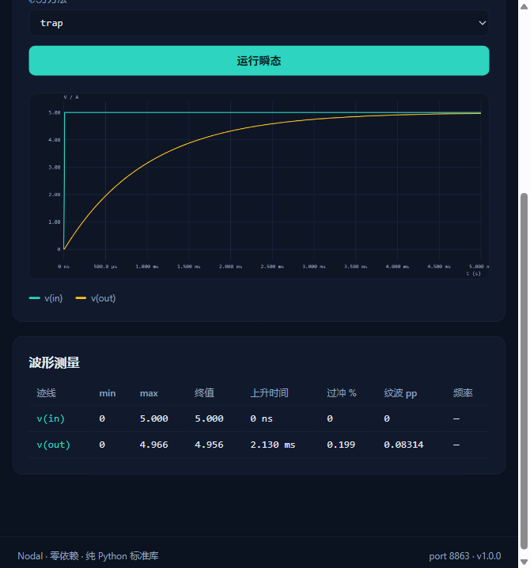
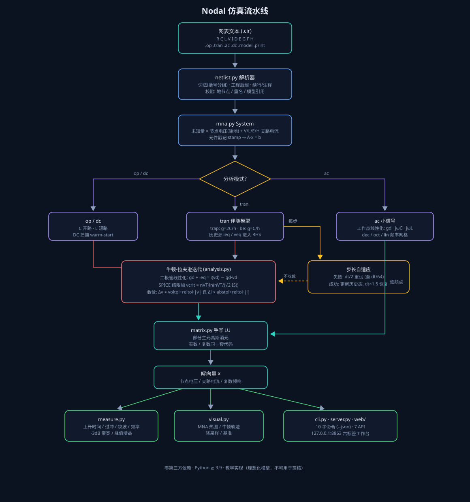
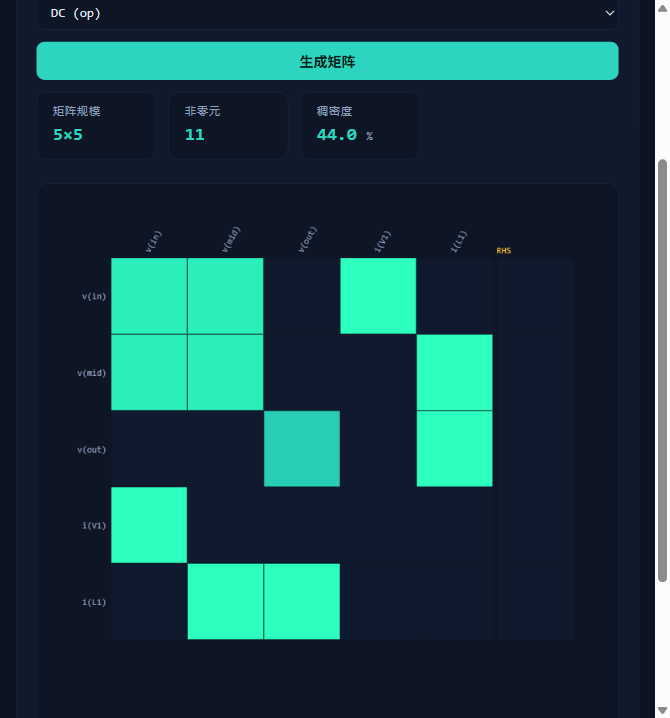
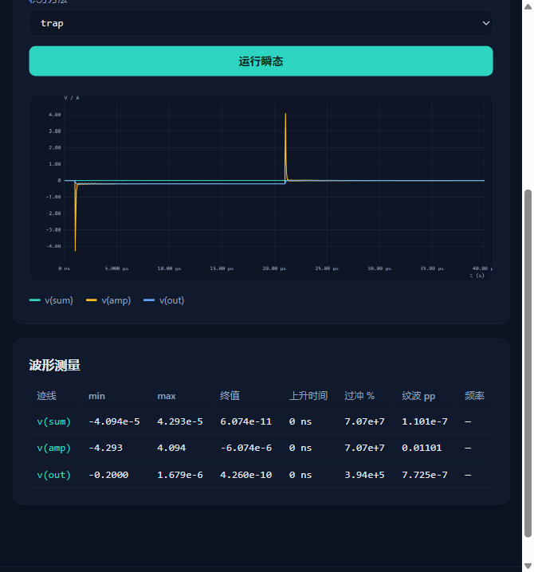

# Nodal

**手写 SPICE 内核的模拟电路仿真器** —— 网表解析 → 改进节点分析（MNA）→ 手写 LU 分解 → 牛顿-拉夫逊 → 瞬态 / AC / DC 扫描，配一个零依赖的浏览器工作台。

纯 Python 标准库实现，**没有任何第三方依赖**（无 numpy / scipy）。从矩阵消元到二极管限幅全部手写，适合学习电路仿真器 internals，也适合快速验证小规模模拟电路的一阶行为。

```
V1 in 0 PULSE(0 5 0 1n 1n 10m 20m)      * RC 阶跃响应
R1 in out 1k
C1 out 0 1u
.tran 10u 5m
.end
```

```console
$ nodal tran rc.cir
transient (trap): 501 points, 0 step retries
  v(in):  min 0  max 5  final 5
  v(out): min 0  max 4.966  final 4.966
```



---

## 功能

| 模块 | 能力 |
|---|---|
| 网表解析 | SPICE 子集：`R C L V I D E G F H`；`.op .tran .ac .dc .model .print .options .end`；`+` 续行、`* $ ;` 注释、工程后缀（`4.7k` `1meg` `10u` `3p`…） |
| 器件模型 | 电阻/电容/电感；独立源 DC / SIN / PULSE（可叠加 AC 小信号幅值与相位）；Shockley 二极管（IS / N，SPICE pn 结限幅）；四种受控源 E/G/F/H |
| 求解器 | 部分主元 LU 分解（同一套代码服务实数与复数矩阵）、牛顿-拉夫逊（reltol/abstol/voltol 收敛判据 + 结电压限幅） |
| 分析 | 直流工作点、DC 源扫描（warm-start）、瞬态（梯形 / 后向欧拉伴随模型，失败步长自动减半、成功后恢复）、AC 小信号扫频（dec / oct / lin，工作点处线性化） |
| 测量 | 终值 / 10-90% 上升时间 / 过冲 / 建立时间 / 纹波 / 均值 / RMS / 频率估计；-3dB 带宽 / 峰值增益 / 指定频率相位 |
| 可视化 | **MNA 戳记矩阵热图**（log 压缩幅值 + RHS 列）、**牛顿收敛轨迹**（每步 max\|Δv\| / max\|Δi\|）、瞬态波形、波特图（幅频 + 相频） |
| 接口 | 10 个 CLI 子命令（全部支持 `--json`）、7 个 HTTP JSON API、六标签浏览器工作台、内嵌基准测试 |

内嵌示例：电阻分压器、RC 阶跃、RLC 带通、半波整流 + 滤波、**光电二极管跨阻放大器（TIA）**——用 VCVS 宏模型搭运放，2 µA 光电流脉冲经 100 kΩ 反馈电阻得到 −0.2 V 输出，可直接观察反馈环路的建立过程。

## 原理

仿真流水线（`docs/nodal_flow.svg` / `.drawio` 为可编辑流程图）：



```
netlist text
   │  netlist.py     词法（括号分组）→ 元件 / 模型 / 分析命令
   ▼
Netlist
   │  mna.py         未知量 = 节点电压(除地) + V/L/E/H 支路电流
   ▼                 每个元件向 A、b 贡献一个"戳记"(stamp)
A·x = b
   │  matrix.py      部分主元高斯消元 LU，实数 / 复数通用
   ▼
   ├─ op / dc   二极管在牛顿迭代中线性化：gd = IS·e^(vd/nVT)/nVT
   │            ieq = i(vd) − gd·vd；SPICE 限幅防止 exp 溢出
   ├─ tran      C → 伴随电导 g = 2C/dt（trap）+ 历史电流源
   │            L → 支路形式 Req = 2L/dt + 历史电压源
   │            每步牛顿求解，失败 dt/2 重试（至 dt/64），成功 ×1.5 恢复
   └─ ac        在工作点线性化全部器件，Y(jω) 复数矩阵逐频求解
```

关键公式：

- **二极管**：`i = IS·(exp(vd/(N·VT)) − 1)`，`VT = 25.865 mV`；`vd/nVT > 40` 时线性延拓防溢出；牛顿步长用 SPICE 临界电压 `vcrit = nVT·ln(nVT/(√2·IS))` 限幅。
- **梯形伴随模型**（电容）：`i(t+h) = (2C/h)·v(t+h) − [(2C/h)·v(t) + i(t)]`，历史项作为注入电流源进入 RHS。
- **AC 线性化**：二极管取微分电导 `gd`，电容 `jωC`，电感支路方程 `v = jωL·i`。

数值正确性用解析解交叉验证（见 `tests/test_analysis.py`）：

| 电路 | 理论值 | Nodal 实测 |
|---|---|---|
| 分压器 10 V × 3k/(2k+3k) | 6.000 V | 6.000000000 V |
| RC 阶跃 t=τ 处 5(1−e⁻¹) | 3.1606 V | 3.1514 V（trap, dt=10 µs，−0.3%） |
| RC 上升时间 2.2τ | 2.2 ms | 2.13 ms |
| RLC 谐振 1/(2π√LC) | 5032.9 Hz | 5012 Hz（40 点/dec 网格分辨率内） |
| RC 低通 −3dB = 1/(2πRC) | 159.2 Hz | 网格内 <3% |
| TIA 平台 −2 µA × 100 kΩ | −0.200 V | −0.2000 V |

## 环境与依赖

- Python **≥ 3.9**（CPython，Windows / Linux / macOS）
- **零第三方依赖**，仅标准库
- 浏览器工作台需要任意现代浏览器（Canvas 2D）

## 安装与运行

```bash
git clone https://github.com/18971181532/nodal.git
cd nodal
pip install -e .          # 安装 nodal 命令（或直接 python -m nodal）
```

### CLI（10 个子命令）

```bash
nodal parse examples/rc_step.cir            # 解析并列出元件/节点/分析
nodal op    examples/divider.cir            # 直流工作点
nodal dc    examples/divider.cir --source V1 --start 0 --stop 10 --step 2
nodal tran  examples/rc_step.cir --method be --step 20u --stop 2m
nodal ac    examples/rlc_bandpass.cir --mode dec --n 40 --start 100 --stop 1meg
nodal run   examples/photodiode_tia.cir     # 执行网表内全部分析
nodal matrix examples/divider.cir           # 打印 MNA 戳记矩阵
nodal newton examples/rectifier.cir         # 牛顿收敛轨迹
nodal bench --stages 24 --points 400        # RC 梯形网络基准
nodal serve --port 8863                     # 浏览器工作台
```

所有子命令支持 `--json`；时间/频率参数接受工程后缀（`10u`、`1meg`）。错误输出到 stderr，退出码 2。

### 浏览器工作台

```bash
nodal serve            # http://127.0.0.1:8863/
```

六个标签页：

| 标签 | 内容 |
|---|---|
| 电路 | 网表编辑器 + 5 个示例 + 解析结构表 + 工作点 |
| 瞬态波形 | trap/be 选择、多迹线 Canvas 波形、测量表（上升时间/过冲/纹波/频率） |
| AC 波特图 | 幅频 + 相频双图、-3dB 带宽 / 峰值增益 |
| MNA 矩阵 | 戳记矩阵热图（log 幅值 + RHS 列）、规模/非零元/稠密度 |
| 牛顿收敛 | 每次迭代 max\|Δv\| / max\|Δi\| 对数轨迹 |
| 参考 | 元件/命令语法表、内核基准、边界声明 |



### Python API

```python
from nodal.netlist import parse
from nodal import analysis, measure

net = parse(open("examples/rc_step.cir").read())
tr  = analysis.transient(net, tstep=1e-5, tstop=5e-3)
obj = analysis._serialise_tran(tr)
print(measure.rise_time(obj["times"], obj["traces"]["v(out)"]))
```

### HTTP API

`POST /api/parse | /api/op | /api/tran | /api/ac | /api/dc | /api/matrix | /api/bench`，`GET /api/info`（含示例网表）。请求体 `{"netlist": "...", ...}`，参数同样接受工程后缀字符串。服务仅绑定 `127.0.0.1`。

## 使用示例：光电二极管 TIA

`examples/photodiode_tia.cir`：

```spice
photodiode transimpedance amplifier
I1 0 sum PULSE(0 2u 1u 10n 10n 20u 40u)   ; 光电流脉冲 + 3pF 结电容
C1 sum 0 3p
E1 amp 0 sum 0 -1e5                        ; 运放宏模型：增益 1e5
R3 amp out 100                             ; 单极点 100 kHz
C2 out 0 15.9n
Rf out sum 100k                            ; 跨阻 100 kΩ
Cf out sum 0.5p                            ; 反馈补偿
.tran 50n 40u
.end
```

```console
$ nodal tran examples/photodiode_tia.cir
transient (trap): 801 points, 0 step retries
  v(out): ... final -0.2      # = −2 µA × 100 kΩ，精确
```



## 测试

```bash
python -m unittest discover -s tests -t . -v
```

105 个测试，覆盖 LU（实/复/奇异/主元）、网表（后缀/波形/续行/错误行号）、MNA 戳记、四种受控源、二极管物理与限幅、全部分析的解析解对标、测量函数、CLI 退出码、HTTP API 正常与 400 路径。CI 在 ubuntu-24.04 × windows-latest × Python 3.9–3.12 共 8 个组合上运行。

## 目录结构

```
nodal/
├── nodal/
│   ├── matrix.py        # 手写 LU：实数/复数通用，部分主元
│   ├── netlist.py       # SPICE 子集解析器（词法/元件/命令/校验）
│   ├── devices.py       # Shockley 二极管 + SPICE 限幅 + SIN/PULSE
│   ├── mna.py           # MNA 未知量编排与元件戳记（op/dc/tran/ac）
│   ├── analysis.py      # 牛顿、工作点、DC/瞬态/AC 扫描、序列化
│   ├── measure.py       # 波形与频响工程测量
│   ├── visual.py        # 矩阵热图/牛顿轨迹/降采样/基准/内嵌示例
│   ├── cli.py           # 10 子命令，全 --json
│   ├── server.py        # 127.0.0.1 HTTP：7 API + 静态工作台
│   └── web/             # index.html / style.css / app.js（无框架）
├── examples/            # 5 个 .cir 网表 + demo.py
├── tests/               # 105 个 unittest
├── docs/
│   ├── nodal_flow.drawio / .svg   # 仿真流水线流程图
│   └── screenshots/               # 工作台截图
├── .github/workflows/tests.yml    # 8 组合 CI 矩阵
├── pyproject.toml
└── README.md
```

## 边界与声明

- **教学实现**：理想化模型，无温度效应、无 BSIM/FinFET、无噪声/蒙特卡洛/ corner 分析；二极管仅 IS/N 两参数；运放需用 E 源宏模型自行搭建。
- 不可用于流片签核或安全关键设计；生产仿真请使用 ngspice / Xyce / Spectre。
- 稠密 LU 为 O(n³)，适合 ≤ 数百节点的电路；大规模电路需要稀疏求解器。
- HTTP 服务仅监听 127.0.0.1，无认证无 TLS，请勿暴露到公网。

## License

MIT
